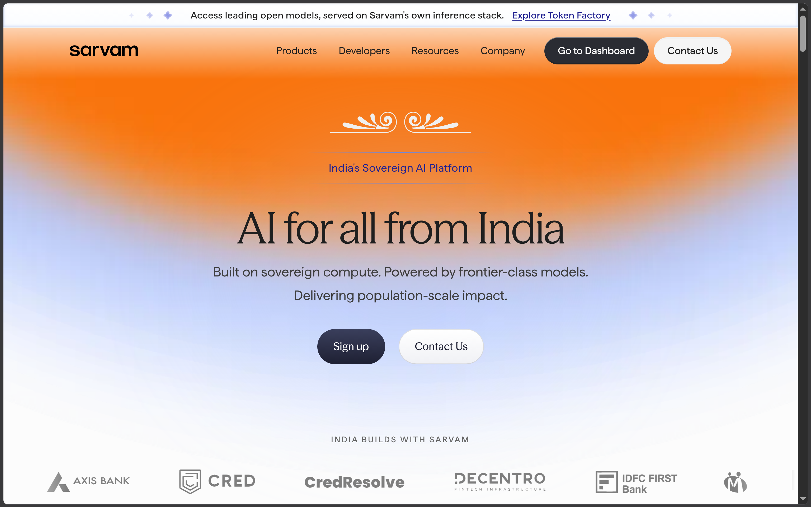

[](https://openclaw.ai/)

# Sarvam AI Plugin for OpenClaw

[](https://www.sarvam.ai/)

Give your OpenClaw agent a voice with one `SARVAM_API_KEY`. Saaras transcribes an incoming recording, a Token Factory model can answer and use tools, and Bulbul speaks the reply. This community plugin lets you enable each service independently, so you can also add speech to an agent that already uses another chat model.

| To enable | Use | Choose |
| --- | --- | --- |
| Incoming voice notes or realtime transcription | Saaras | `saaras:v3`, `saaras:v4`. The modern v3 streaming model is `saaras:v3-realtime`. |
| Agent conversations and tools | Token Factory | Select an entitled chat model from your account's live catalog, such as `glm5.3-flash`. |
| Spoken replies or streaming audio | Bulbul | `bulbul:v3` with `shubh`, or `bulbul:v4-flash` with `shubh_enhi_ads`. |
| Decision and embedding APIs | Token Factory | Prism and provisioned Clef for decisions. Provisioned EmbeddingGemma for memory search. |

## Install the review build

Use Node.js 24.16 or later in the 24.x line, or Node.js 26.1 or later. The tested host versions are OpenClaw 2026.11.5 and 2026.11.6. Install FFmpeg and FFprobe on the Gateway machine. The package includes the compiled JavaScript and uses the host Plugin SDK.

```sh
git clone --branch feat/sarvam-provider https://github.com/ANAMASGARD/openclaw-sarvam.git
cd openclaw-sarvam
npm ci --ignore-scripts
npm run build
npm pack
openclaw plugins install "npm-pack:$PWD/openclaw-plugin-sarvam-0.1.0.tgz"
openclaw plugins enable sarvam
```

Review the local-source and capability prompts during installation. After public ClawHub release, the registry installation command is `openclaw plugins install clawhub:openclaw-plugin-sarvam@0.1.0`. See the test report for this build's publication status.

## Connect your Sarvam account

Use OpenClaw's interactive credential prompt to store your key. For a specific agent, add `--agent <id>`. Operators using environment credentials can set `SARVAM_API_KEY` in the process that launches their Gateway. A managed Gateway needs the variable in its own service environment. Keep credentials out of Git.

```sh
openclaw models auth login --provider sarvam --method api-key
openclaw models list --all --provider sarvam --refresh
```

The three switches are `plugins.entries.sarvam.config.stt`, `tts` and `tokenFactory`. Installing the package preserves an operator's selected chat model. To use Sarvam for agent replies, choose its model explicitly with `openclaw models set sarvam/glm5.3-flash`.

## Configure speech

Merge the settings you need into your existing OpenClaw configuration. Use the complete [speech-only example](examples/speech-only.json) with your current language model, the [models-only example](examples/models-only.json) for text agents, or the [voice-agent example](examples/voice-agent.json) for all three services.

```json
{
  "tools": {
    "media": {
      "audio": { "enabled": true, "language": "en-IN" },
      "models": [{ "provider": "sarvam", "model": "saaras:v4", "capabilities": ["audio"] }]
    }
  },
  "tts": {
    "auto": "inbound",
    "provider": "sarvam",
    "providers": {
      "sarvam": { "modelId": "bulbul:v3", "speaker": "shubh", "language": "en-IN" }
    }
  }
}
```

This example transcribes with v4 and speaks with v3. Set `tts.auto` to `always` for spoken replies to text messages too. Run `openclaw config validate` after editing and reload your Gateway. Once your Telegram bot or WhatsApp account is connected to OpenClaw, send a short voice note in the approved private chat. OpenClaw passes the transcript to its agent, and Bulbul returns mono Ogg/Opus for voice-note delivery. [OpenClaw Telegram setup](https://docs.openclaw.ai/channels/telegram) · [OpenClaw WhatsApp setup](https://docs.openclaw.ai/channels/whatsapp)

## Provider details

- Saaras supports short recordings, durable multi-file Batch jobs, modern realtime transcription and the legacy WebSocket protocol. The plugin measures recordings locally. Files longer than 30 seconds use Batch. [STT options, recovery and verification](docs/stt.md)
- Bulbul supports buffered synthesis, streamed HTTP audio, WebSocket synthesis and telephony PCM. The provider validates voices and settings for the selected model. [TTS options, codecs and verification](docs/tts.md)
- Token Factory discovers entitlements from `GET /v2/models`. Agent tool loops, stateless Responses, decisions and embeddings have separate contracts. Some models require organisation provisioning. [Catalog and per-model results](docs/factory.md)
- Hosted Sarvam Voice Agents (Samvaad), phone-number provisioning, calls, campaigns, translation and document processing are separate products outside this version. Realtime transcription and speech synthesis can be consumed independently through the public host APIs.

## Privacy and troubleshooting

Audio, text, and model inputs selected for Sarvam processing go to Sarvam. Batch transfers use signed storage URLs. The plugin bounds requests and buffers and keeps signed URLs, raw upstream errors and credentials out of its diagnostics. It uses the current account for each operation. See the Batch guide for encrypted local job data and recovery after a key rotation.

If a voice note produces no reply, check `openclaw plugins inspect sarvam --runtime --json`, `openclaw config validate` and `openclaw channels status --probe`. Confirm the agent has Sarvam credentials, an audio-capable entry under `tools.media.models`, and a model-specific Bulbul speaker under top-level `tts`. HTTP 401/403 indicate credential or permission problems. HTTP 402 indicates insufficient credit. HTTP 429 indicates a rate limit. A provisioned-only model can appear in discovery and still reject an inference request.

## Verification

```sh
npm ci --ignore-scripts
npm run typecheck
npm test
npm run validate
npm run lint
npm run test:package
npm audit --omit=dev
```

The live channel suite sent all four speech-model combinations to a private Telegram chat and to a linked WhatsApp self-chat. It submitted generated audio through OpenClaw, downloaded Telegram's stored replies, and verified the audio accepted for each WhatsApp send. Handset-originated voice conversations and provisioning-restricted Token Factory services remain open release checks. [Test report](docs/TEST_REPORT.md)

To repeat billed tests, prepare the public FLEURS samples following the Saaras guide, set `SARVAM_API_KEY` or `SARVAM_TEST_KEY_FILE`, and run `SARVAM_LIVE_TEST=1 npm run test:live`. The separate channel suite uses explicitly selected private recipients. [Saaras fixtures](docs/stt.md) · [Channel verification](docs/channel-tests.md)

Licensed under MIT. The package icon uses Tabler's MIT-licensed wave-sine artwork. [Project license](LICENSE) · [Icon license](assets/Tabler-LICENSE.txt)
